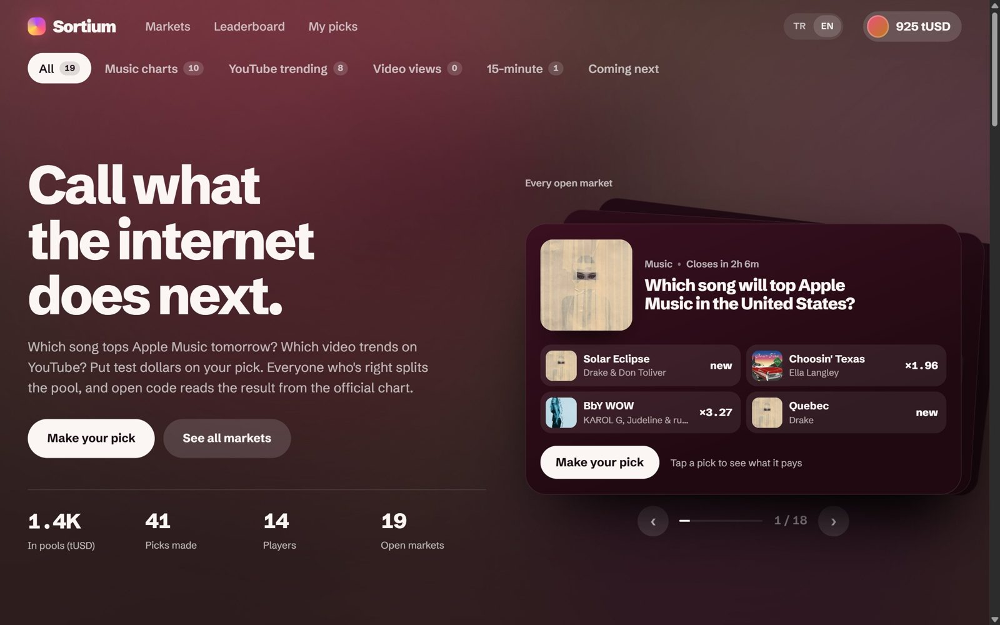
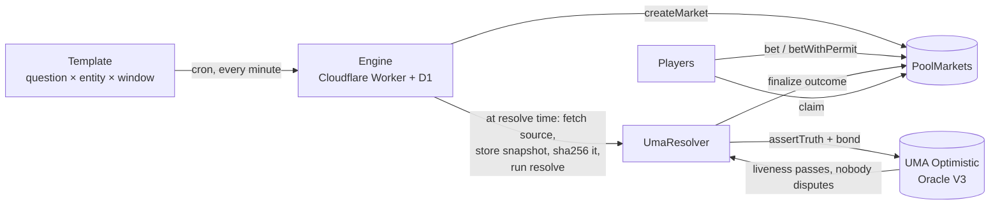
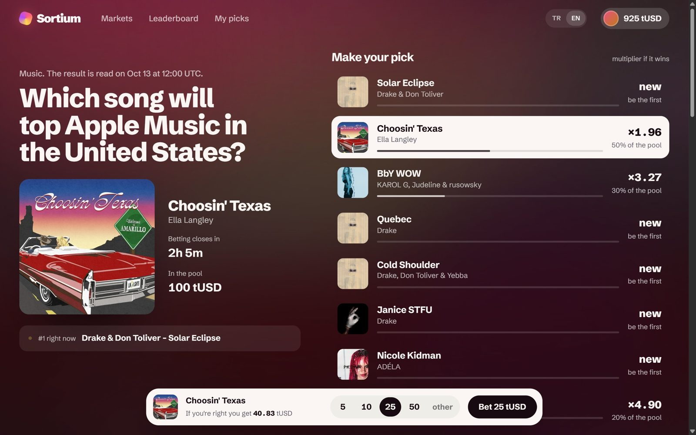
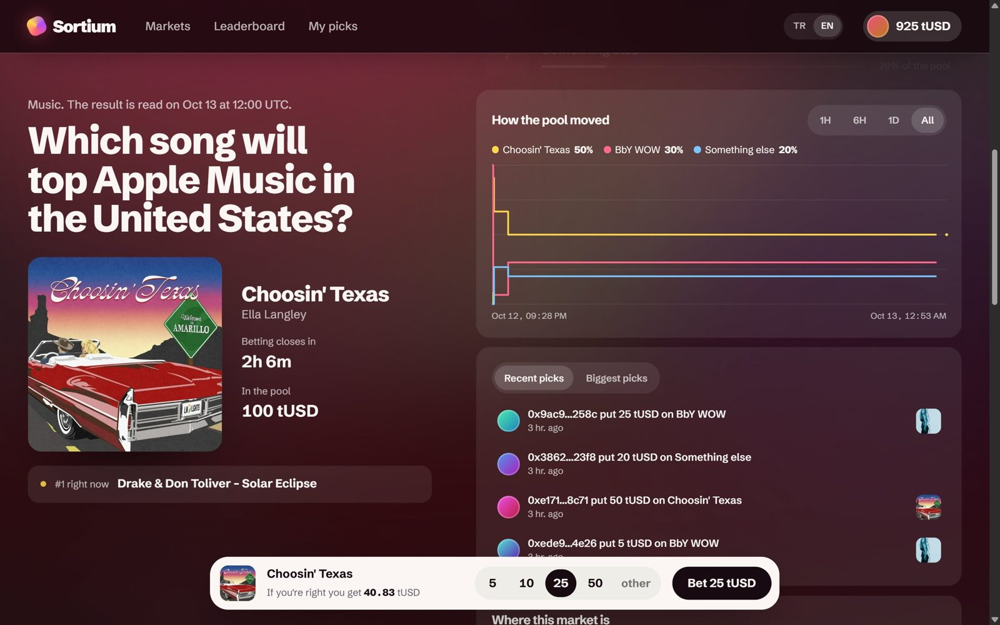
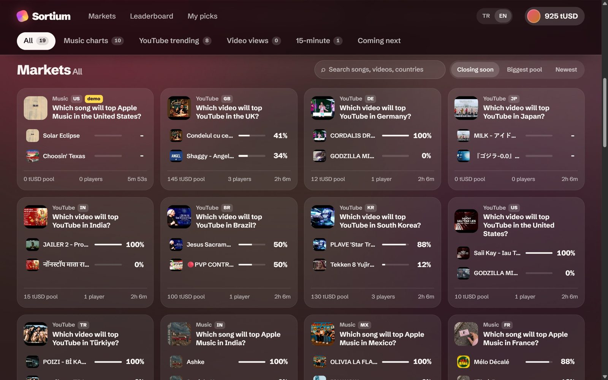

<div align="center">

# Sortium

**Pick what the internet does next.**

Pool-betting prediction markets on public internet charts: which song tops Apple Music in a country tomorrow, which video tops YouTube trending, how many views a creator's new video gets in 24 hours. Markets open themselves from templates, and open code reads the official source to decide them. The result goes to UMA's Optimistic Oracle on Arbitrum, where anyone can dispute it.

[**Live app**](https://sortium.sortium.deno.net) · [Engine API](https://cwf-engine.l3ekirerdem.workers.dev/api/markets) · [PoolMarkets on Arbiscan](https://sepolia.arbiscan.io/address/0x950863296D8d229ee7B847E20B7960E8C7f6C41a) · Arbitrum Sepolia · English / Türkçe



</div>

> Built for the **Colosseum Crypto World's Fair** hackathon, Arbitrum track. **Testnet only**: every market is played with tUSD, a test token with no value.

---

## Contents

- [At a glance](#at-a-glance)
- [The problem](#the-problem)
- [How Sortium works](#how-sortium-works)
- [Market templates](#market-templates)
- [Trust model](#trust-model)
- [Architecture](#architecture)
- [Deployed contracts](#deployed-contracts)
- [Try it in two minutes](#try-it-in-two-minutes)
- [Verify any result yourself](#verify-any-result-yourself)
- [Run it locally](#run-it-locally)
- [Tests](#tests)
- [Known limitations](#known-limitations)
- [Roadmap](#roadmap)
- [Hackathon notes](#hackathon-notes)

## At a glance

| | |
|---|---|
| **What** | Parimutuel (pool) prediction markets on chart positions and view counts, opened automatically from templates |
| **Chain** | Arbitrum Sepolia (chain id 421614) |
| **Settlement** | Deterministic resolver code proposes the outcome to UMA Optimistic Oracle V3, which runs a dispute window |
| **Money** | tUSD, our own ERC-20 test token (6 decimals, EIP-2612 permit). The faucet gives 1,000 a day |
| **Fee** | 2% of the pool, taken only when a market resolves. Cancelled markets refund everyone in full |
| **Live now** | Daily Apple Music markets in 10 countries, YouTube trending markets in 8 regions, a rolling 15-minute demo market, and view-count markets for 5 tracked creators |
| **Stack** | Solidity 0.8.28 + Foundry · Cloudflare Worker + D1 (engine) · React 19 + Vite + viem (app) · Deno Deploy (hosting) |

## The problem

- **Fun markets die on order books.** A question like "which song is #1 tomorrow in Brazil" attracts a few dozen players, not market makers. An order book with 15 outcomes and thin liquidity mostly shows empty prices. A pool needs no counterparty: everyone pays into one pot, and whoever was right splits it.
- **Writing every market by hand doesn't scale.** The large venues grow with templates rather than by inventing questions one at a time: one question shape × many entities × repeating windows. Sortium is a template factory from day one.
- **Resolution is where trust breaks.** Rules drift, sources disappear, and an admin decides. In Sortium the rule is a pure function in this repository, the raw evidence is stored and its hash goes onchain, and the outcome passes through UMA's dispute window.

## How Sortium works



**Lifecycle of one market**

| Step | What happens | Who |
|---|---|---|
| Open | The engine reads the live chart, picks the candidates (current top songs or videos plus "Something else") and calls `createMarket` | Engine |
| Betting | Players back an outcome. Each outcome has its own pool, and the payout multiplier is `total pool × 0.98 / outcome pool` | Anyone |
| Lock | No more bets after `lockTime` (12 hours before the result for daily markets) | Contract |
| Propose | At `resolveTime` the engine fetches the source, stores the raw response, hashes it and runs the template's `resolve()`. It then calls `UmaResolver.propose`, which posts an assertion with a bond to UMA OOv3 | Engine (the call is permissionless) |
| Dispute window | 2 hours for daily markets, 5 minutes for demo markets. Anyone can dispute on UMA | Anyone |
| Settle | After liveness, `settle` triggers UMA's callback and `PoolMarkets.finalize` records the winner | Anyone |
| Claim | Winners claim their share. If nobody backed the winner, or the source was unavailable for 6 hours, the market is **void** and every stake is refunded | Players |

One full round on the live deployment: market #11 took bets, locked, and was proposed to UMA (assertion `0x79cdaa0d…c64b`). It passed liveness, settled and paid out, and `bun run verify 11` returned `MATCH`.

## Market templates

| Key | Question | Source | Cadence |
|---|---|---|---|
| `AM_TOP_COUNTRY` | Which song will top Apple Music in {country} tomorrow? | Apple's Most Played feed (`rss.marketingtools.apple.com`) | Daily, 10 storefronts: TR, US, KR, BR, JP, DE, GB, FR, MX, IN |
| `AM_TOP_DEMO` | The same question on a minutes-long clock (labelled demo) | Same feed | A new market every 15 minutes, open for 14 |
| `YT_TOP_COUNTRY` | Which video will top YouTube trending in {region} tomorrow? | YouTube Data API v3 `videos.list?chart=mostPopular` | Daily, 8 regions |
| `YT_VIEWS_24H` | How many views will {creator}'s new video have 24 hours after publishing? | YouTube Data API v3 `videos.list` statistics | Opens within an hour of an upload by MrBeast, IShowSpeed, Dude Perfect, Sidemen or Barış Özcan |

Each template is a small object with three functions:
- `drafts()` decides which markets to open now.
- `snapshot()` fetches the raw source.
- `resolve()` is a pure function from snapshot to outcome index.

The pure resolvers live in [`packages/templates/src/resolve/`](packages/templates/src/resolve).

## Trust model

What you can check yourself, and what you currently have to trust:

| Property | Status |
|---|---|
| The outcome comes from a public source | ✅ The raw response is stored and served at `/api/evidence/{id}`, and its sha256 is in the UMA claim text |
| Anyone can recompute the result | ✅ `bun run verify <id>` downloads the evidence, checks the hash against the onchain claim and re-runs `resolve()` |
| Anyone can propose or dispute | ✅ `UmaResolver.propose` is permissionless, and disputes go through UMA OOv3 |
| UMA can't strand funds | ✅ Resolver callbacks never revert (they are wrapped in `try/catch`), so UMA settlement always completes. Anyone can void a market nobody resolved within 7 days |
| Refunds on bad sources | ✅ If the source is unavailable for 6 hours, or nobody backed the winner, the market is void and every stake is refunded |
| No operator custody | ✅ Stakes sit in `PoolMarkets`; only the 2% fee goes to the treasury |
| Resolver code is bound onchain | ⚠️ Each template's `codeHash` (keccak of its resolver source) is registered onchain as a label. Nothing forces the engine to run that exact code; the protection is that a wrong proposal can be disputed |
| No admin can change outcomes | ⚠️ **Testnet setup:** one key is owner, operator and treasury. The owner can call `setResolver` with no timelock, so a malicious owner could install a resolver that finalizes any outcome. A mainnet version needs a timelock or a resolver fixed per market |
| Someone watches for wrong proposals | ⚠️ The engine follows proposals made by others but does not dispute them automatically yet |

## Architecture

```
sortium/
├── contracts/            Foundry: TestUSD, PoolMarkets, UmaResolver + unit, fuzz and fork tests
├── packages/templates/   Templates, pure resolvers, code hashes, registration, verifier CLI, seed script
├── workers/engine/       Cloudflare Worker (cron + API) with D1: factory, resolver, settler, indexer, faucet
└── app/                  React + Vite PWA, served from Deno Deploy (app/deno/main.ts)
```

| Component | Key files | Responsibility |
|---|---|---|
| `PoolMarkets` | [`contracts/src/PoolMarkets.sol`](contracts/src/PoolMarkets.sol) | Templates, markets, pools per outcome, `bet` / `betWithPermit`, `finalize`, `voidMarket`, `claim` and fee accounting. Limits: 1 tUSD minimum bet, 500 tUSD per address per market, 2 to 16 outcomes |
| `UmaResolver` | [`contracts/src/UmaResolver.sol`](contracts/src/UmaResolver.sol) | Builds the human-readable claim (outcome, evidence hash, URI), posts it to OOv3 with the minimum bond, and handles the resolved and disputed callbacks |
| `TestUSD` | [`contracts/src/TestUSD.sol`](contracts/src/TestUSD.sol) | ERC-20 with EIP-2612 permit, 6 decimals, a daily faucet and a dripper role for the engine |
| Templates | [`packages/templates/src/templates/`](packages/templates/src/templates) | `drafts` / `snapshot` / `resolve` for each question shape |
| Engine | [`workers/engine/src/index.ts`](workers/engine/src/index.ts) | Every minute, under a D1 lock, in this order (details below the table) |
| Activity index | [`workers/engine/src/activity.ts`](workers/engine/src/activity.ts) | Indexes `BetPlaced` and `Claimed` with exact block timestamps. Serves `/api/activity`, `/api/stats`, `/api/leaderboard` and pool totals per market |
| App | [`app/src`](app/src) | Home with a live market deck, categories and search; market pages with a pool history chart; bet slip, leaderboard and my picks. EIP-6963 wallet discovery plus an instant in-browser test wallet |

Each engine run, in order:
1. Confirm transactions sent in earlier runs.
2. Propose markets whose resolve time has passed.
3. Settle markets whose dispute window has passed.
4. Open new markets, one template per minute.
5. Index new bets and claims.

A run sends at most 10 transactions, which keeps it inside the Workers subrequest limit.

**Engine API** (public and read-only, except the faucet)

| Endpoint | Returns |
|---|---|
| `GET /api/markets?status=open\|all` | Markets with artwork and pool totals per outcome |
| `GET /api/markets/{id}` | One market with a live reading of the source ("#1 right now") |
| `GET /api/evidence/{id}` | The raw snapshot the proposal was made from |
| `GET /api/activity?limit=&market=` | Recent bets and claims |
| `GET /api/stats` · `GET /api/leaderboard` | Volume, bets and players · top players |
| `POST /api/faucet` | 1,000 tUSD + 0.0003 ETH, once per address per day, up to 8 wallets per network per day |

## Deployed contracts

Arbitrum Sepolia, chain id 421614.

| Contract | Address |
|---|---|
| PoolMarkets | [`0x950863296D8d229ee7B847E20B7960E8C7f6C41a`](https://sepolia.arbiscan.io/address/0x950863296D8d229ee7B847E20B7960E8C7f6C41a) |
| UmaResolver | [`0x15F8C0C400beDE3d228A88af1360e4e3e899D623`](https://sepolia.arbiscan.io/address/0x15F8C0C400beDE3d228A88af1360e4e3e899D623) |
| TestUSD (tUSD) | [`0x15cA921E97e8E3c33C1DAf63DBdfD173b4e1C970`](https://sepolia.arbiscan.io/token/0x15cA921E97e8E3c33C1DAf63DBdfD173b4e1C970) |
| UMA Optimistic Oracle V3 (deployed by UMA) | [`0x1037A21a30aEfF90c269b01c3933eB9a5285d9b8`](https://sepolia.arbiscan.io/address/0x1037A21a30aEfF90c269b01c3933eB9a5285d9b8) |

## Try it in two minutes

1. Open **[sortium.sortium.deno.net](https://sortium.sortium.deno.net)**.
2. Click **Start with 1,000 test dollars** and choose **Instant wallet**. A test wallet opens in your browser, and the faucet sends it 1,000 tUSD and a little test ETH. There is nothing to install.
   - To use your own wallet instead: MetaMask, Rabby and OKX Wallet work, and the app adds Arbitrum Sepolia for you. Phantom does not support Arbitrum Sepolia.
3. Pick a market in the deck or the grid, tap an outcome, choose an amount and press **Bet**. A pick is usually one transaction (a permit signature plus the bet). Wallets whose permit signatures the token can't verify are asked for an approval first.
4. Watch the pool chart, the live picks feed and the leaderboard update. Daily markets are read at 12:00 UTC, and the 15-minute demo market settles within half an hour.

| Market page | Pool history and picks |
|---|---|
|  |  |



## Verify any result yourself

```bash
bun install
cd packages/templates
bun run verify <marketId>
```

The verifier does three things:
1. Fetches the evidence from the engine.
2. Checks its sha256 against the hash in the onchain UMA claim.
3. Re-runs the template's `resolve()` and compares the result with the proposed outcome.

`MATCH` means the proposal is honest. `MISMATCH` means you should dispute it on UMA before the window closes.

## Run it locally

**Prerequisites:** [Bun](https://bun.sh) 1.3+, [Foundry](https://getfoundry.sh), Node 20+ for Wrangler, and optionally [Deno](https://deno.com) 2.x to host the app.

```bash
git clone https://github.com/Bekirerdem/sortium.git && cd sortium
bun install
git submodule update --init --recursive      # OpenZeppelin + forge-std for contracts/
```

| Part | Command | Notes |
|---|---|---|
| App | `cd app && bun run dev` | Uses the live engine by default; set `VITE_ENGINE_URL` to point at your own |
| Engine | `cd workers/engine && bunx wrangler dev` | Needs a D1 database (`schema.sql`) and the secrets `OPERATOR_KEY`, `FAUCET_KEY` and, optionally, `YOUTUBE_API_KEY` |
| Contracts | `cd contracts && forge build && forge test` | `script/Deploy.s.sol` deploys the three contracts |
| Templates | `cd packages/templates && bun run register` | Registers the templates onchain; `scripts/gen-hashes.ts` regenerates the code hashes |
| Hosting | `cd app && bun run deploy:deno` | Builds and uploads to Deno Deploy |

## Tests

| Package | Command | Result |
|---|---|---|
| Contracts | `cd contracts && forge test` | 25 passing, including fuzz tests on payouts and a fork test against the real UMA OOv3 on Arbitrum Sepolia |
| Templates | `cd packages/templates && bun test` | 17 passing: resolvers, view-count brackets, drafts, and a check that the code hashes are current |
| Engine | `cd workers/engine && bun test` | 13 passing: scheduling logic, faucet limits, artwork, activity index |
| App | `cd app && bun test src/lib && bun run build` | 19 passing (pool math, questions in both languages, categories, pool history), plus a type-checked build |

## Known limitations

- **Single operator key on testnet.** See [Trust model](#trust-model): `setResolver` has no timelock.
- **A market can stay "proposed" if UMA never resolves a dispute.** Stale-void is blocked while a proposal is pending. A mainnet version should allow voiding after the dispute period plus a grace window.
- **Stuck engine transactions** (dropped from the mempool) are not retried automatically. On testnet the 7-day stale void is the backstop.
- **Lone winners pay the fee.** If only the winning outcome was backed, its backers get 98% back.
- **Wallet warnings on free hosting.** MetaMask flags every `*.pages.dev` and `*.workers.dev` origin as a drainer, which is why the app is served from Deno Deploy.

## Roadmap

- More templates from the same factory: Spotify and Billboard charts, Netflix Top 10, Steam launch peaks, streamer peaks, words said in speeches, weather.
- Creator-opened markets with a share of the fee.
- An auto-disputer that re-runs `resolve()` on every proposal and disputes mismatches.
- Mainnet with native USDC, a timelocked admin and per-market resolvers.

## Hackathon notes

- **Event:** Colosseum Crypto World's Fair, Arbitrum track.
- **Prior work:** none. Everything in this repository was written during the hackathon.
- **Third-party code and services:** UMA Optimistic Oracle V3 (deployed by UMA), OpenZeppelin Contracts, viem, forge-std, GSAP, Apple's public Most Played feed and the YouTube Data API.
- **Test data disclosure:** part of the early activity on the live deployment comes from ten team test wallets, used to fill the feed and the leaderboard. They are not users.

## License

[MIT](LICENSE)
